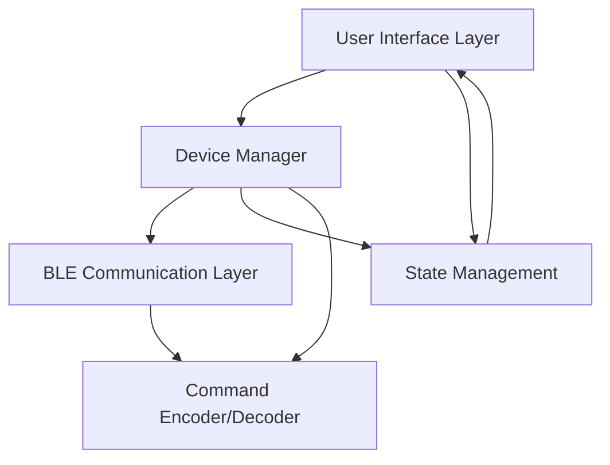

# Design Document: Govee Bluetooth Dashboard

## Overview

The Govee Bluetooth Dashboard is a web-based application that provides a testing and control interface for Govee smart devices using the Web Bluetooth API. The application follows a modular architecture with clear separation between BLE communication, device management, state management, and UI rendering.

The system is designed to run in modern web browsers that support the Web Bluetooth API (Chrome, Edge, Opera) and provides real-time control of multiple Govee devices simultaneously. The architecture emphasizes testability, maintainability, and extensibility to support various Govee device types.

## Architecture

### High-Level Architecture



### Technology Stack

- **Frontend Framework**: React with TypeScript for type safety and component-based architecture
- **BLE Communication**: Web Bluetooth API for browser-based Bluetooth Low Energy access
- **State Management**: React Context API with useReducer for predictable state updates
- **UI Components**: Tailwind CSS for styling with custom components for device controls
- **Build Tool**: Vite for fast development and optimized production builds
- **Testing**: Vitest for unit tests, fast-check for property-based testing

### Key Architectural Decisions

1. **Web-based Application**: Using Web Bluetooth API allows cross-platform support without native app development
2. **Modular Design**: Separation of concerns enables independent testing and future extensibility
3. **Type Safety**: TypeScript throughout ensures compile-time error detection
4. **Reactive State**: Centralized state management provides predictable UI updates

## Components and Interfaces

### 1. BLE Communication Layer

**Responsibility**: Handle low-level Bluetooth communication with Govee devices

**Key Classes/Modules**:

```typescript
interface BLEDevice {
  id: string;
  name: string;
  rssi: number;
  device: BluetoothDevice;
  server?: BluetoothRemoteGATTServer;
}

interface BLEService {
  scanForDevices(): Promise<BLEDevice[]>;
  connect(device: BLEDevice): Promise<void>;
  disconnect(device: BLEDevice): Promise<void>;
  readCharacteristic(device: BLEDevice, serviceUuid: string, charUuid: string): Promise<DataView>;
  writeCharacteristic(device: BLEDevice, serviceUuid: string, charUuid: string, data: Uint8Array): Promise<void>;
  subscribeToCharacteristic(device: BLEDevice, serviceUuid: string, charUuid: string, callback: (data: DataView) => void): Promise<void>;
}
```

**Govee BLE Protocol Constants**:
- Primary Service UUID: `00010203-0405-0607-0809-0a0b0c0d1910`
- Control Characteristic UUID: `00010203-0405-0607-0809-0a0b0c0d2b11`
- Command packet format: 20-byte arrays with checksum

### 2. Command Encoder/Decoder

**Responsibility**: Translate high-level commands to Govee BLE protocol and decode responses

**Key Functions**:

```typescript
interface GoveeCommand {
  power(on: boolean): Uint8Array;
  brightness(level: number): Uint8Array; // 0-255
  color(r: number, g: number, b: number): Uint8Array;
  parseState(data: DataView): DeviceState;
}

interface DeviceState {
  power: boolean;
  brightness: number;
  color: { r: number; g: number; b: number };
}
```

**Command Format**:
- Byte 0: Command type (0x33 for control)
- Byte 1: Sub-command (0x01 power, 0x04 brightness, 0x05 color)
- Bytes 2-18: Command-specific data
- Byte 19: XOR checksum of bytes 0-18

### 3. Device Manager

**Responsibility**: Orchestrate device lifecycle, maintain device registry, coordinate commands

**Key Interface**:

```typescript
interface DeviceManager {
  discoverDevices(): Promise<void>;
  connectDevice(deviceId: string): Promise<void>;
  disconnectDevice(deviceId: string): Promise<void>;
  sendCommand(deviceId: string, command: Uint8Array): Promise<void>;
  getDeviceState(deviceId: string): Promise<DeviceState>;
  getDevices(): Map<string, ManagedDevice>;
}

interface ManagedDevice {
  id: string;
  name: string;
  connectionState: 'disconnected' | 'connecting' | 'connected' | 'error';
  rssi: number;
  state: DeviceState | null;
  lastError?: string;
}
```

### 4. State Management

**Responsibility**: Centralized application state with predictable updates

**State Structure**:

```typescript
interface AppState {
  devices: Map<string, ManagedDevice>;
  scanning: boolean;
  debugMode: boolean;
  selectedDeviceId: string | null;
}

type AppAction =
  | { type: 'SCAN_START' }
  | { type: 'SCAN_COMPLETE'; devices: ManagedDevice[] }
  | { type: 'DEVICE_CONNECTED'; deviceId: string }
  | { type: 'DEVICE_DISCONNECTED'; deviceId: string }
  | { type: 'DEVICE_STATE_UPDATED'; deviceId: string; state: DeviceState }
  | { type: 'DEVICE_ERROR'; deviceId: string; error: string }
  | { type: 'TOGGLE_DEBUG_MODE' };
```

### 5. UI Components

**Component Hierarchy**:

```
App
├── DeviceScanner
│   └── ScanButton
├── DeviceList
│   └── DeviceCard
│       ├── ConnectionStatus
│       ├── SignalStrength
│       └── DeviceControls
│           ├── PowerToggle
│           ├── BrightnessSlider
│           └── ColorPicker
└── DebugPanel (conditional)
    └── CharacteristicViewer
```

## Data Models

### Device Model

```typescript
interface Device {
  id: string;
  name: string;
  rssi: number;
  connectionState: ConnectionState;
  capabilities: DeviceCapabilities;
  state: DeviceState | null;
  bleDevice: BluetoothDevice;
  lastSeen: Date;
}

type ConnectionState = 'disconnected' | 'connecting' | 'connected' | 'error';

interface DeviceCapabilities {
  supportsPower: boolean;
  supportsBrightness: boolean;
  supportsColor: boolean;
  supportsTemperature: boolean;
}

interface DeviceState {
  power: boolean;
  brightness?: number;
  color?: RGB;
  temperature?: number;
}

interface RGB {
  r: number; // 0-255
  g: number; // 0-255
  b: number; // 0-255
}
```

### Command Model

```typescript
interface Command {
  type: CommandType;
  payload: Uint8Array;
  timestamp: Date;
}

enum CommandType {
  POWER = 'power',
  BRIGHTNESS = 'brightness',
  COLOR = 'color',
  STATE_QUERY = 'state_query'
}
```

## Correctness Properties

*A property is a characteristic or behavior that should hold true across all valid executions of a system—essentially, a formal statement about what the system should do. Properties serve as the bridge between human-readable specifications and machine-verifiable correctness guarantees.*

### Property 1: Device discovery completeness
*For any* scan operation, all devices returned by the scan should have valid IDs, names, and RSSI values (non-null, RSSI in range -100 to -30 dBm).
**Validates: Requirements 1.2, 9.1**

### Property 2: Connection state consistency
*For any* device, after a successful connection operation, the device's connection state should be 'connected', and after a successful disconnection operation, the state should be 'disconnected'.
**Validates: Requirements 2.4, 3.2**

### Property 3: Command checksum validity
*For any* generated Govee command packet, the checksum byte (byte 19) should equal the XOR of bytes 0-18.
**Validates: Requirements 4.1, 5.1, 6.2**

### Property 4: Input value bounds validation
*For any* brightness or color command, all numeric values (brightness 0-255, RGB components 0-255) should be validated and clamped to their valid ranges before encoding.
**Validates: Requirements 5.3, 6.3**

### Property 5: Multi-device independence
*For any* two connected devices, sending a command to one device should not modify the state or connection status of the other device.
**Validates: Requirements 8.3**

### Property 6: State update propagation
*For any* device state change (power, brightness, color), the UI should reflect the new state within the specified timeout period (2 seconds).
**Validates: Requirements 4.2, 6.4, 7.4**

### Property 7: Command throttling preservation
*For any* sequence of rapid brightness changes, the throttling mechanism should ensure commands are sent at most once per throttle interval, and the final value should eventually be sent.
**Validates: Requirements 5.2**

### Property 8: Connection queue ordering
*For any* sequence of connection requests, they should be processed in the order they were received (FIFO).
**Validates: Requirements 2.5**

### Property 9: Disconnection cleanup
*For any* device disconnection, all characteristic subscriptions and resources associated with that device should be released.
**Validates: Requirements 3.4**

### Property 10: Error state recovery
*For any* failed command, the UI state should revert to the previous known good state, maintaining consistency.
**Validates: Requirements 4.3**

### Property 11: Device state reading completeness
*For any* connected device, the system should read and display all supported state properties (power, brightness if supported, color if supported) after connection.
**Validates: Requirements 7.1, 7.2, 7.3**

### Property 12: UI control availability
*For any* device, control elements (power toggle, brightness slider, color picker) should only be enabled when the device is connected and supports that capability.
**Validates: Requirements 4.4, 5.4, 6.1**

## Error Handling

### Error Categories

1. **BLE API Errors**
   - Browser doesn't support Web Bluetooth
   - User cancels device selection
   - Device out of range
   - Connection timeout

2. **Device Communication Errors**
   - Invalid characteristic UUID
   - Write operation fails
   - Read operation timeout
   - Unexpected disconnection

3. **Protocol Errors**
   - Invalid command format
   - Checksum mismatch
   - Unsupported device type

4. **Application Errors**
   - Invalid state transitions
   - Concurrent operation conflicts

### Error Handling Strategy

```typescript
class BLEError extends Error {
  constructor(
    message: string,
    public code: BLEErrorCode,
    public deviceId?: string,
    public recoverable: boolean = true
  ) {
    super(message);
  }
}

enum BLEErrorCode {
  NOT_SUPPORTED = 'NOT_SUPPORTED',
  USER_CANCELLED = 'USER_CANCELLED',
  DEVICE_NOT_FOUND = 'DEVICE_NOT_FOUND',
  CONNECTION_FAILED = 'CONNECTION_FAILED',
  COMMAND_FAILED = 'COMMAND_FAILED',
  TIMEOUT = 'TIMEOUT'
}
```

**Error Recovery**:
- Automatic retry for transient errors (max 3 attempts)
- User notification for non-recoverable errors
- Graceful degradation (disable unavailable features)
- Connection state reset on critical errors

## Testing Strategy

### Unit Testing

Unit tests will verify specific behaviors and edge cases:

- **BLE Service**: Mock BluetoothDevice API responses
- **Command Encoder**: Test specific command formats and checksums
- **Device Manager**: Test state transitions and error handling
- **UI Components**: Test rendering and user interactions

Example unit tests:
- Empty device list renders correctly
- Power command generates correct byte sequence
- Connection failure updates device state to 'error'
- Brightness slider disabled when device disconnected

### Property-Based Testing

Property-based tests will verify universal properties across all inputs using **fast-check** library:

- Each property test will run a minimum of 100 iterations
- Tests will use smart generators that constrain inputs to valid ranges
- Each test will be tagged with the format: `**Feature: govee-bluetooth-dashboard, Property {number}: {property_text}**`

**Generators**:
- `arbDevice()`: Generate random device objects with valid IDs, names, RSSI
- `arbRGB()`: Generate RGB values in range 0-255
- `arbBrightness()`: Generate brightness values in range 0-255
- `arbCommand()`: Generate valid command packets
- `arbDeviceState()`: Generate valid device states

**Property Test Examples**:
- Command checksum calculation is correct for all possible command bytes
- Brightness clamping works for any input number
- RGB validation accepts all valid values and rejects invalid ones
- State updates maintain consistency across any sequence of operations

### Integration Testing

- Test full flow: scan → connect → control → disconnect
- Test multi-device scenarios
- Test error recovery paths
- Test Web Bluetooth API integration with real devices (manual testing)

### Test Organization

```
src/
├── services/
│   ├── ble.service.ts
│   ├── ble.service.test.ts
│   └── ble.service.properties.test.ts
├── utils/
│   ├── command-encoder.ts
│   ├── command-encoder.test.ts
│   └── command-encoder.properties.test.ts
├── components/
│   ├── DeviceCard.tsx
│   └── DeviceCard.test.tsx
└── __tests__/
    └── integration/
        └── device-control.test.ts
```

## Security Considerations

1. **User Consent**: Web Bluetooth API requires explicit user interaction for device pairing
2. **Origin Restrictions**: HTTPS required for Web Bluetooth API access
3. **Device Permissions**: Browser manages Bluetooth permissions per origin
4. **Data Validation**: All user inputs validated before sending to devices
5. **Error Information**: Avoid exposing sensitive device information in error messages

## Performance Considerations

1. **Command Throttling**: Limit command rate to prevent overwhelming devices (max 10 commands/second per device)
2. **State Caching**: Cache device state to reduce unnecessary BLE reads
3. **Efficient Rendering**: Use React.memo and useMemo to prevent unnecessary re-renders
4. **Connection Pooling**: Reuse GATT connections when possible
5. **Debouncing**: Debounce slider inputs to reduce command frequency

## Future Extensibility

1. **Device Profiles**: Support for different Govee device types (sensors, plugs, etc.)
2. **Scene Management**: Save and recall device configurations
3. **Scheduling**: Time-based automation
4. **Device Groups**: Control multiple devices simultaneously
5. **Cloud Integration**: Optional cloud API support for extended features
